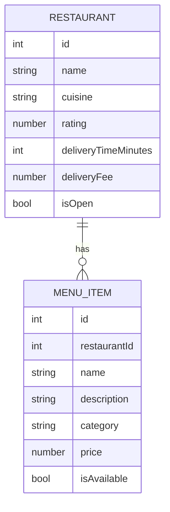

    # Goeat API — Frontend Contract

REST API for a food delivery system. This document is the contract between the backend and the frontend: build against it, and tell the backend owner before assuming anything that is not written here.

**Status:** all data is currently **mocked** (in-memory, read-only). Only `GET` endpoints exist. `order` and `address` are placeholders.

## Access

| | |
|---|---|
| Base URL (local) | `http://localhost:5143` |
| API prefix | `/api/v1` |
| Format | JSON, `camelCase` property names |
| Auth | None (all endpoints are public) |
| Interactive docs | `/swagger` |
| Health check | `GET /health` -> `200 Healthy` (plain text) when the API and its database are up; `503 Unhealthy` otherwise. Not versioned, not part of the API prefix |
| Machine-readable (routes only) | `/openapi/v1.json`, also saved in `docs/openapi.json` |

Notes:
- Local HTTPS profile: `https://localhost:7017`.
- The generated OpenAPI file only lists routes and parameters, not response schemas. **This document is the source of truth for response shapes.**
- CORS is enabled for an allow-list of origins. In local development these are `http://localhost:3000`, `http://localhost:4200` and `http://localhost:5173`. For any other origin (including the deployed frontend), ask the backend owner to add it.

## Entities

### Restaurant

| Field | Type | Description |
|---|---|---|
| `id` | integer | Unique id |
| `name` | string | Display name |
| `cuisine` | string | Cuisine type, e.g. `Burgers`, `Pizza`, `Japanese`, `Mexican` |
| `rating` | number | Average rating, 0–5 (one decimal) |
| `deliveryTimeMinutes` | integer | Estimated delivery time |
| `deliveryFee` | number | Delivery fee (currency amount, 2 decimals) |
| `isOpen` | boolean | Whether the restaurant is currently accepting orders |

```json
{
  "id": 1,
  "name": "Burger House",
  "cuisine": "Burgers",
  "rating": 4.7,
  "deliveryTimeMinutes": 30,
  "deliveryFee": 5.00,
  "isOpen": true
}
```

### MenuItem

| Field | Type | Description |
|---|---|---|
| `id` | integer | Unique item id |
| `restaurantId` | integer | `Restaurant.id` this item belongs to |
| `name` | string | Item name |
| `description` | string | Short description |
| `category` | string | Menu section, e.g. `Burgers`, `Sides`, `Drinks`, `Pizzas`, `Desserts`, `Combos`, `Starters`, `Tacos` |
| `price` | number | Price (currency amount, 2 decimals) |
| `isAvailable` | boolean | `false` = show as unavailable, don't allow ordering |

```json
{
  "id": 4,
  "restaurantId": 1,
  "name": "Milkshake",
  "description": "Chocolate or vanilla",
  "category": "Drinks",
  "price": 16.00,
  "isAvailable": false
}
```

Relationship: a `Restaurant` has many `MenuItem`s (`MenuItem.restaurantId` → `Restaurant.id`).

## Endpoints

### Restaurants

#### `GET /api/v1/restaurants`
List restaurants.

| Query param | Type | Required | Description |
|---|---|---|---|
| `cuisine` | string | no | Case-insensitive exact match on `cuisine` |

- `200` → `Restaurant[]` (empty array `[]` if the filter matches nothing)

#### `GET /api/v1/restaurants/{id}`
Get one restaurant.

| Path param | Type | Description |
|---|---|---|
| `id` | integer | `Restaurant.id` |

- `200` → `Restaurant`
- `404` → not found ([error shape](#errors))

### Menu

#### `GET /api/v1/restaurants/{restaurantId}/menu`
List a restaurant's menu items.

| Path param | Type | Description |
|---|---|---|
| `restaurantId` | integer | `Restaurant.id` |

| Query param | Type | Required | Description |
|---|---|---|---|
| `category` | string | no | Case-insensitive exact match on `category` |

- `200` → `MenuItem[]`
- `404` → unknown restaurant **or** the category filter matched nothing. A `404` here is **not** an empty list; treat it as "no items".

#### `GET /api/v1/restaurants/{restaurantId}/menu/{itemId}`
Get one menu item.

| Path param | Type | Description |
|---|---|---|
| `restaurantId` | integer | `Restaurant.id` |
| `itemId` | integer | `MenuItem.id` (must belong to that restaurant) |

- `200` → `MenuItem`
- `404` → not found

### Placeholders (not final)

These return a fixed message and will change. Do not build UI against them yet.

| Method | Path | `200` response |
|---|---|---|
| `GET` | `/api/v1/order` | `{ "message": "Order information retrieved successfully." }` |
| `GET` | `/api/v1/address` | `{ "message": "Address information retrieved successfully." }` |

## Errors

Error responses use RFC 9457 problem details (`application/problem+json`):

```json
{
  "type": "https://tools.ietf.org/html/rfc9110#section-15.5.5",
  "title": "Not Found",
  "status": 404,
  "traceId": "00-bb3e47dee2266a5efe00884cfcb203a7-5c27b23985caeb41-00"
}
```

Branch on the HTTP status code; `title` and `traceId` are for logging.

A non-integer id (e.g. `/restaurants/abc`) matches no route and returns `404`.

## Mock data available

| Restaurant id | Name | Cuisine | Open | Menu item ids |
|---|---|---|---|---|
| 1 | Burger House | Burgers | yes | 1–4 |
| 2 | Pizzaria Napoli | Pizza | yes | 5–7 |
| 3 | Sushi Kyoto | Japanese | **no** | 8–9 |
| 4 | Taco Loco | Mexican | yes | 10–12 |

## Diagram



```
GET /api/v1/restaurants                                  -> Restaurant[]
GET /api/v1/restaurants/{id}                             -> Restaurant
GET /api/v1/restaurants/{restaurantId}/menu              -> MenuItem[]
GET /api/v1/restaurants/{restaurantId}/menu/{itemId}     -> MenuItem
```

## Change policy

The backend owner updates this file whenever a route, field or status code changes. If the frontend needs something that is not here (new field, new endpoint, CORS, auth), request it instead of working around it.
