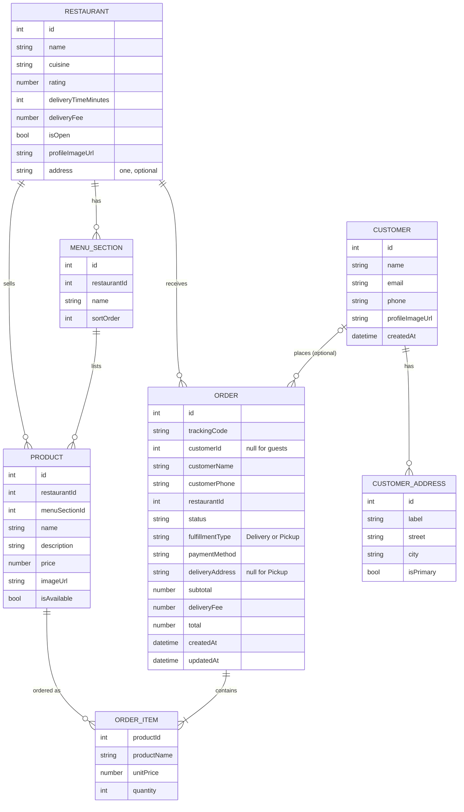

# Goeat API — Frontend Contract

REST API for a food delivery system. This document is the contract between the backend and the frontend: build against it, and tell the backend owner before assuming anything that is not written here.

**Status:** data lives in PostgreSQL. There are three kinds of users:

| Who | Can do |
|---|---|
| **Anyone** (no account) | Browse restaurants, menus and products. **Place an order as a guest** and track it with a tracking code |
| **Customer** (account) | Everything a guest can, plus: orders linked to the account and order history |
| **Restaurant** (account) | Register, edit its profile (including open/closed), **manage its menu** (sections and products: create, edit, delete) and **see the orders it received** |

`address` is still a placeholder.

## Breaking changes in this version

Frontend code written against the previous contract must be updated:

| Before | Now |
|---|---|
| `Menu` had `id` and `name` | `Menu` is now `{ restaurantId, sections[] }` (no `id`, no `name`) |
| `POST /restaurants/{id}/products` was public | Requires the **restaurant's own** token (`403` for any other restaurant, `401` without a token). Invalid `menuSectionId` is now `400` (was `404`) |
| `POST /orders` required a customer token | **Public.** A customer token is optional (see [Orders](#orders)) |
| `POST /orders` body | New required fields `fulfillmentType` and `paymentMethod`; `deliveryAddress` only for `Delivery`; `customerName` and `customerPhone` for guests |
| `Order` | New fields `trackingCode`, `customerName`, `customerPhone`, `fulfillmentType`, `paymentMethod`; `customerId` can be `null`; `deliveryAddress` can be `null`; `deliveryFee` is `0` for `Pickup` |
| `GET /orders`, `GET /orders/{id}` | Require a **customer** token (a restaurant token gets `403`) |
| Token claims | Tokens now carry a `role` claim (`customer` or `restaurant`). Decode it to know who is logged in |
| `Order` | New field `updatedAt`. Status can now change: new `PATCH /restaurants/me/orders/{id}/status` and `POST /orders/{id}/cancel` |
| `GET /customers/me` | Requires a **customer** token (a restaurant token gets `403`) |
| `Restaurant`, `RestaurantAccount`, `Customer` | New fields `profileImageUrl` (string or `null`) on all three and `address` (object or `null`) on both restaurant views. `PUT /restaurants/me` accepts the new optional `profileImageUrl` (omitting it clears the image) |

Unchanged: customer `POST /auth/register` and `POST /auth/login`, `GET /products/{id}`, `GET /restaurants...`.

## Access

| | |
|---|---|
| Base URL (local) | `http://localhost:5143` |
| API prefix | `/api/v1` |
| Format | JSON, `camelCase` property names. Enums are sent and received as **strings** (e.g. `"Delivery"`) |
| Auth | JWT Bearer token (see [Authentication](#authentication)). Browsing and guest ordering are public |
| Interactive docs | `/swagger` |
| Health check | `GET /health` -> `200 Healthy` (plain text) when the API and its database are up; `503 Unhealthy` otherwise. Not versioned, not part of the API prefix |
| Machine-readable (routes only) | `/openapi/v1.json`, also saved in `docs/openapi.json` |

Notes:
- Local HTTPS profile: `https://localhost:7017`.
- The generated OpenAPI file only lists routes and parameters, not response schemas. **This document is the source of truth for request and response shapes.**
- CORS is enabled for an allow-list of origins. In local development these are `http://localhost:3000`, `http://localhost:4200` and `http://localhost:5173`. For any other origin (including the deployed frontend), ask the backend owner to add it.
- Money values are JSON numbers and may omit trailing zeros (`6`, `42.5`, `42.50` are all possible). Parse them as numbers and format for display yourself. Dates are ISO 8601 with UTC offset (e.g. `2026-10-20T06:24:45.9640508+00:00`).

## Authentication

There are two kinds of accounts, with separate login endpoints, but the token is used the same way.

| Account | Register | Login |
|---|---|---|
| Customer | `POST /api/v1/auth/register` | `POST /api/v1/auth/login` |
| Restaurant | `POST /api/v1/auth/restaurants/register` | `POST /api/v1/auth/restaurants/login` |

Send the token on protected endpoints: `Authorization: Bearer <accessToken>`.

- The token is valid for 60 minutes (`expiresAt` in the login response). There is no refresh token yet: when a protected call returns `401`, log in again.
- The token is a JWT. Its payload has `sub` (the customer or restaurant id), `role` (`customer` or `restaurant`), `email` and `name` (and `phone` for customers). Use `role` to decide which screens to show.
- `401` = no token / invalid / expired. `403` = valid token of the wrong kind (e.g. a customer calling a restaurant endpoint) or acting on another restaurant's resources.

Legend used below: 🔓 public, 🔒C requires a **customer** token, 🔒R requires a **restaurant** token.

## Entities

### Restaurant (public view)

| Field | Type | Description |
|---|---|---|
| `id` | integer | Unique id |
| `name` | string | Display name |
| `cuisine` | string | Cuisine type, e.g. `Burgers`, `Pizza`, `Japanese` |
| `rating` | number | Average rating, 0–5. `0` for new restaurants |
| `deliveryTimeMinutes` | integer | Estimated delivery time |
| `deliveryFee` | number | Delivery fee charged on `Delivery` orders |
| `isOpen` | boolean | Whether the restaurant is accepting orders. Orders to a closed restaurant are rejected |
| `profileImageUrl` | string \| null | Profile image URL, `null` when there is none |
| `address` | RestaurantAddress \| null | Where the restaurant is located, `null` until the restaurant registers it |

```json
{ "id": 5, "name": "Restaurante Demo", "cuisine": "Burgers", "rating": 4.5, "deliveryTimeMinutes": 30, "deliveryFee": 5.00, "isOpen": true, "profileImageUrl": "https://picsum.photos/seed/restaurante-demo/300", "address": { "street": "Avenida Paulista", "number": "1000", "complement": "Loja 2", "neighborhood": "Bela Vista", "city": "São Paulo", "state": "SP", "zipCode": "01310-100" } }
```

### RestaurantAddress

A restaurant has **one** address at most.

| Field | Type | Description |
|---|---|---|
| `street` | string | Street name |
| `number` | string | Street number (string, e.g. `"S/N"`) |
| `complement` | string | null | Suite, floor, etc. |
| `neighborhood` | string | Neighborhood |
| `city` | string | City |
| `state` | string | 2-letter state code, upper-case |
| `zipCode` | string | Postal code (CEP) |

### RestaurantAccount (what a restaurant sees about itself)

Same fields as `Restaurant`, plus:

| Field | Type | Description |
|---|---|---|
| `email` | string \| null | Login email (lower-case) |
| `phone` | string \| null | Contact phone |
| `createdAt` | string (date-time) | Registration time |

```json
{ "id": 7, "name": "Sabor Caseiro", "cuisine": "Brazilian", "rating": 0.0, "deliveryTimeMinutes": 40, "deliveryFee": 6, "isOpen": false, "profileImageUrl": null, "address": null, "email": "sabor.contract@example.com", "phone": "11933332222", "createdAt": "2026-10-20T06:24:23.374358+00:00" }
```

The 4 demo restaurants (ids 1–4) have no account, so nobody can log in as them.

### Product

| Field | Type | Description |
|---|---|---|
| `id` | integer | Unique id |
| `restaurantId` | integer | `Restaurant.id` that sells it |
| `menuSectionId` | integer | `MenuSection.id` it is listed under |
| `name` | string | Product name (max 150) |
| `description` | string | Short description (max 500) |
| `price` | number | Unit price |
| `imageUrl` | string \| null | Image URL, `null` when there is none |
| `isAvailable` | boolean | `false` = show as unavailable; orders containing it are rejected |

```json
{ "id": 4, "restaurantId": 1, "menuSectionId": 3, "name": "Milkshake", "description": "Chocolate or vanilla", "price": 16.00, "imageUrl": null, "isAvailable": false }
```

### MenuSection

```json
{ "id": 13, "name": "Pratos", "sortOrder": 1 }
```

### Menu

A restaurant's menu is the list of its sections (sorted by `sortOrder`), each with its products. A new restaurant has `sections: []`.

```json
{
  "restaurantId": 7,
  "sections": [
    {
      "id": 13,
      "name": "Pratos",
      "sortOrder": 1,
      "products": [
        { "id": 17, "restaurantId": 7, "menuSectionId": 13, "name": "Feijoada", "description": "Feijoada completa", "price": 42.50, "imageUrl": null, "isAvailable": true }
      ]
    }
  ]
}
```

### Customer

| Field | Type | Description |
|---|---|---|
| `id` | integer | Unique id |
| `name` | string | Full name |
| `email` | string | Lower-case, unique |
| `phone` | string | Phone number |
| `profileImageUrl` | string \| null | Profile image URL, `null` when there is none |
| `createdAt` | string (date-time) | Registration time |

The password is never returned.

```json
{ "id": 2, "name": "Maria Silva", "email": "maria.contract@example.com", "phone": "11988887777", "profileImageUrl": null, "createdAt": "2026-10-20T06:04:50.8590228+00:00" }
```

### CustomerAddress

A customer can have several addresses; exactly one is the **primary** one (the first address created is primary automatically).

| Field | Type | Description |
|---|---|---|
| `id` | integer | Unique id |
| `label` | string | Name chosen by the customer, e.g. `Home`, `Work` |
| `street`, `number`, `complement`, `neighborhood`, `city`, `state`, `zipCode` | | Same as `RestaurantAddress` |
| `isPrimary` | boolean | `true` for the primary address |

```json
{ "id": 1, "label": "Home", "street": "Rua das Flores", "number": "123", "complement": null, "neighborhood": "Centro", "city": "São Paulo", "state": "SP", "zipCode": "01001-000", "isPrimary": true }
```

### Order

| Field | Type | Description |
|---|---|---|
| `id` | integer | Unique id |
| `trackingCode` | string | Unguessable code (32 hex chars). Use it with `GET /orders/track/{trackingCode}`. **Show it to guests / keep it in the browser**: it is the only way a guest can find the order again |
| `customerId` | integer \| null | `null` for guest orders |
| `customerName` | string | Who ordered (guest-provided, or the account name) |
| `customerPhone` | string | Contact phone (guest-provided, or the account phone) |
| `restaurantId` | integer | `Restaurant.id` |
| `status` | string | One of `Pending`, `Confirmed`, `Preparing`, `OutForDelivery`, `Delivered`, `Cancelled`. New orders are `Pending`. See [Order status flow](#order-status-flow) |
| `fulfillmentType` | string | `Delivery` (delivered to `deliveryAddress`) or `Pickup` (customer collects at the restaurant) |
| `paymentMethod` | string | `Cash`, `CreditCard`, `DebitCard` or `Pix`. It only records how the customer intends to pay; **the API does not process or charge payments**, the customer pays on delivery/pickup |
| `deliveryAddress` | string \| null | Delivery address. `null` for `Pickup` |
| `subtotal` | number | Sum of the item line totals |
| `deliveryFee` | number | Restaurant fee for `Delivery`; always `0` for `Pickup` |
| `total` | number | `subtotal + deliveryFee` |
| `createdAt` | string (date-time) | Creation time |
| `updatedAt` | string (date-time) | When the status last changed. Equals `createdAt` for a new order |
| `items[]` | array | See below |

`items[]` entries are snapshots taken when the order was placed, so later price, name or deletion of a product does not change old orders:

| Field | Type | Description |
|---|---|---|
| `productId` | integer | `Product.id` (the product may no longer exist) |
| `productName` | string | Name at order time |
| `unitPrice` | number | Price at order time |
| `quantity` | integer | 1–99 |
| `lineTotal` | number | `unitPrice * quantity` |

```json
{
  "id": 7,
  "trackingCode": "93af7cf88b3241aeb057f8b65fa7d42e",
  "customerId": null,
  "customerName": "Joao Souza",
  "customerPhone": "11955554444",
  "restaurantId": 7,
  "status": "Pending",
  "fulfillmentType": "Delivery",
  "paymentMethod": "Pix",
  "deliveryAddress": "Rua das Flores, 123 - Centro",
  "subtotal": 85.00,
  "deliveryFee": 6.00,
  "total": 91.00,
  "createdAt": "2026-10-20T06:24:45.9640508+00:00",
  "items": [
    { "productId": 17, "productName": "Feijoada", "unitPrice": 42.50, "quantity": 2, "lineTotal": 85.00 }
  ]
}
```

## Endpoints

### Browsing (🔓 public)

#### 🔓 `GET /api/v1/restaurants`

| Query param | Type | Required | Description |
|---|---|---|---|
| `cuisine` | string | no | Case-insensitive exact match on `cuisine` |

- `200` → `Restaurant[]` (`[]` if none). Includes closed restaurants (`isOpen: false`).

#### 🔓 `GET /api/v1/restaurants/{id}`
- `200` → `Restaurant`
- `404` → not found

#### 🔓 `GET /api/v1/restaurants/{restaurantId}/menu`
- `200` → `Menu`
- `404` → the restaurant does not exist

#### 🔓 `GET /api/v1/restaurants/{restaurantId}/products`
Flat list of the restaurant's products.

| Query param | Type | Required | Description |
|---|---|---|---|
| `available` | boolean | no | `true` = only available products, `false` = only unavailable ones |

- `200` → `Product[]` (`[]` if none)

#### 🔓 `GET /api/v1/products/{id}`
- `200` → `Product`
- `404` → not found

### Restaurant account

#### 🔓 `POST /api/v1/auth/restaurants/register`
Create a restaurant account. The restaurant starts **closed** (`isOpen: false`) with an empty menu; call `PUT /restaurants/me` with `isOpen: true` when it is ready to receive orders.

| Field | Type | Required | Rules |
|---|---|---|---|
| `name` | string | yes | 2–150 characters |
| `cuisine` | string | yes | 2–80 characters |
| `email` | string | yes | Valid email, up to 254 characters. Stored lower-case, must be unique |
| `phone` | string | yes | 8–30 characters |
| `password` | string | yes | 8–100 characters |
| `deliveryTimeMinutes` | integer | yes | 1–240 |
| `deliveryFee` | number | yes | 0–1000 |

```json
{ "name": "Sabor Caseiro", "cuisine": "Brazilian", "email": "sabor.contract@example.com", "phone": "11933332222", "password": "Passw0rd!", "deliveryTimeMinutes": 40, "deliveryFee": 6 }
```

- `201` → `RestaurantAccount`
- `400` → validation error ([shape](#errors))
- `409` → email already registered

#### 🔓 `POST /api/v1/auth/restaurants/login`

```json
{ "email": "sabor.contract@example.com", "password": "Passw0rd!" }
```

- `200` →

```json
{
  "accessToken": "eyJhbGciOiJIUzI1NiIs...",
  "tokenType": "Bearer",
  "expiresAt": "2026-10-20T07:24:23.6819869+00:00",
  "restaurant": { "id": 7, "name": "Sabor Caseiro", "...": "RestaurantAccount" }
}
```

- `400` → validation error
- `401` → wrong email or password (same response for both, on purpose)

#### 🔒R `GET /api/v1/restaurants/me`
- `200` → `RestaurantAccount`
- `401` / `403`

#### 🔒R `PUT /api/v1/restaurants/me`
Replace the profile. Send all fields.

| Field | Type | Required | Rules |
|---|---|---|---|
| `name` | string | yes | 2–150 characters |
| `cuisine` | string | yes | 2–80 characters |
| `phone` | string | yes | 8–30 characters |
| `deliveryTimeMinutes` | integer | yes | 1–240 |
| `deliveryFee` | number | yes | 0–1000 |
| `isOpen` | boolean | yes | `true` = accepting orders |
| `profileImageUrl` | string | no | Valid URL, up to 500 characters. Omitted or empty clears the image |

The email cannot be changed here.

- `200` → `RestaurantAccount`
- `400` / `401` / `403`

#### 🔒R `PUT /api/v1/restaurants/me/address`
Create or replace the restaurant's only address. It then shows up in `address` on `GET /restaurants` and `GET /restaurants/{id}`.

| Field | Type | Required | Rules |
|---|---|---|---|
| `street` | string | yes | 2–150 characters |
| `number` | string | yes | Up to 20 characters |
| `complement` | string | no | Up to 100 characters |
| `neighborhood` | string | yes | 2–100 characters |
| `city` | string | yes | 2–100 characters |
| `state` | string | yes | Exactly 2 letters (stored upper-case) |
| `zipCode` | string | yes | 8–10 characters |

- `200` → `RestaurantAddress`
- `400` / `401` / `403`

### Menu management (🔒R, own restaurant only)

For every endpoint in this section, `{restaurantId}` **must be the logged-in restaurant's id** (`sub` of the token), otherwise the API answers `403`.

#### 🔒R `POST /api/v1/restaurants/{restaurantId}/menu/sections`

| Field | Type | Required | Rules |
|---|---|---|---|
| `name` | string | yes | 1–80 characters |
| `sortOrder` | integer | no | 0–1000. When omitted the section goes to the end |

```json
{ "name": "Pratos" }
```

- `201` → `MenuSection`
- `400` / `401` / `403`

#### 🔒R `PUT /api/v1/restaurants/{restaurantId}/menu/sections/{sectionId}`
Same body as create. `sortOrder` omitted = keep the current position.
- `200` → `MenuSection`
- `400` / `401` / `403`
- `404` → section not found in this restaurant

#### 🔒R `DELETE /api/v1/restaurants/{restaurantId}/menu/sections/{sectionId}`
- `204` → deleted
- `401` / `403`
- `404` → section not found in this restaurant
- `409` → the section still has products (move or delete them first)

#### 🔒R `POST /api/v1/restaurants/{restaurantId}/products`

| Field | Type | Required | Rules |
|---|---|---|---|
| `menuSectionId` | integer | yes | Must be a section of **this** restaurant |
| `name` | string | yes | 1–150 characters |
| `description` | string | yes | 1–500 characters |
| `price` | number | yes | 0.01 – 100000 |
| `imageUrl` | string | no | Valid URL, up to 500 characters |
| `isAvailable` | boolean | no | Defaults to `true` |

```json
{ "menuSectionId": 13, "name": "Feijoada", "description": "Feijoada completa", "price": 42.5 }
```

- `201` → `Product` (`Location` header points to `GET /api/v1/products/{id}`)
- `400` → validation error, including a `menuSectionId` that is not a section of this restaurant (`errors.MenuSectionId`)
- `401` / `403`

#### 🔒R `PUT /api/v1/restaurants/{restaurantId}/products/{productId}`
Replace the product. Same body and rules as create (send all fields). Use `isAvailable: false` to mark a product as sold out without deleting it.
- `200` → `Product`
- `400` / `401` / `403`
- `404` → product not found in this restaurant

#### 🔒R `DELETE /api/v1/restaurants/{restaurantId}/products/{productId}`
- `204` → deleted (old orders keep their snapshot of the product)
- `401` / `403`
- `404` → product not found in this restaurant

### Customer account

#### 🔓 `POST /api/v1/auth/register`

| Field | Type | Required | Rules |
|---|---|---|---|
| `name` | string | yes | 2–150 characters |
| `email` | string | yes | Valid email, up to 254 characters. Stored lower-case |
| `phone` | string | yes | 8–30 characters |
| `password` | string | yes | 8–100 characters |

```json
{ "name": "Maria Silva", "email": "maria.contract@example.com", "phone": "11988887777", "password": "Passw0rd!" }
```

- `201` → `Customer`
- `400` → validation error
- `409` → email already registered

#### 🔓 `POST /api/v1/auth/login`

```json
{ "email": "maria.contract@example.com", "password": "Passw0rd!" }
```

- `200` →

```json
{
  "accessToken": "eyJhbGciOiJIUzI1NiIs...",
  "tokenType": "Bearer",
  "expiresAt": "2026-10-20T07:04:51.1109376+00:00",
  "customer": { "id": 2, "name": "Maria Silva", "email": "maria.contract@example.com", "phone": "11988887777", "createdAt": "2026-10-20T06:04:50.8590228+00:00" }
}
```

- `400` → validation error
- `401` → wrong email or password

#### 🔒C `GET /api/v1/customers/me`
- `200` → `Customer`
- `401` / `403`

#### 🔒C `PUT /api/v1/customers/me`
Replace the profile. Send all fields. Email cannot be changed here.

| Field | Type | Required | Rules |
|---|---|---|---|
| `name` | string | yes | 2–150 characters |
| `phone` | string | yes | 8–30 characters |
| `profileImageUrl` | string | no | Valid URL, up to 500 characters. Omitted or empty clears the image |

- `200` → `Customer`
- `400` / `401` / `403`

#### 🔒C `GET /api/v1/customers/me/addresses`
The customer's addresses, primary first.

- `200` → `CustomerAddress[]`
- `401` / `403`

#### 🔒C `POST /api/v1/customers/me/addresses`

| Field | Type | Required | Rules |
|---|---|---|---|
| `label` | string | yes | 1–50 characters |
| `street` | string | yes | 2–150 characters |
| `number` | string | yes | Up to 20 characters |
| `complement` | string | no | Up to 100 characters |
| `neighborhood` | string | yes | 2–100 characters |
| `city` | string | yes | 2–100 characters |
| `state` | string | yes | Exactly 2 letters (stored upper-case) |
| `zipCode` | string | yes | 8–10 characters |
| `isPrimary` | boolean | no | `true` makes it the primary address (the previous one stops being primary). The first address is always primary |

- `201` → `CustomerAddress`
- `400` / `401` / `403`

#### 🔒C `PUT /api/v1/customers/me/addresses/{id}`
Same body as `POST`. `isPrimary: true` moves the primary flag to this address; `false` on the current primary is ignored (promote another address instead).

- `200` → `CustomerAddress`
- `400` / `401` / `403`
- `404` → no such address for this customer

#### 🔒C `DELETE /api/v1/customers/me/addresses/{id}`
Deleting the primary address promotes the oldest remaining one.

- `204`
- `401` / `403`
- `404` → no such address for this customer

### Orders

#### 🔓 `POST /api/v1/orders`
Place an order. **Anyone can call this**, with or without an account. The server computes prices and totals; do not send them.

- **Guest** (no `Authorization` header): `customerName` and `customerPhone` are required.
- **Logged-in customer** (valid customer token): send the header; the name and phone come from the account (`customerName` / `customerPhone` in the body are ignored) and the order is linked to the customer (`customerId`, shows up in `GET /orders`).
- If the header carries an invalid or expired token, the call is treated as a **guest** call (so `customerName` and `customerPhone` are required). A restaurant token is also treated as a guest.

| Field | Type | Required | Rules |
|---|---|---|---|
| `restaurantId` | integer | yes | Must exist and be open |
| `fulfillmentType` | string | yes | `Delivery` or `Pickup` |
| `paymentMethod` | string | yes | `Cash`, `CreditCard`, `DebitCard` or `Pix` |
| `deliveryAddress` | string | when `Delivery` | 5–300 characters. Ignored for `Pickup` (stored as `null`) |
| `customerName` | string | guests only | 2–150 characters |
| `customerPhone` | string | guests only | 8–30 characters |
| `items` | array | yes | 1–50 entries |
| `items[].productId` | integer | yes | Must belong to `restaurantId` and be available |
| `items[].quantity` | integer | yes | 1–99. Repeated `productId` entries are merged (quantities summed, max 99 per product) |

Guest delivery order:

```json
{
  "restaurantId": 7,
  "fulfillmentType": "Delivery",
  "paymentMethod": "Pix",
  "customerName": "Joao Souza",
  "customerPhone": "11955554444",
  "deliveryAddress": "Rua das Flores, 123 - Centro",
  "items": [ { "productId": 17, "quantity": 2 } ]
}
```

Pickup order (no address, no delivery fee):

```json
{
  "restaurantId": 7,
  "fulfillmentType": "Pickup",
  "paymentMethod": "Cash",
  "customerName": "Joao Souza",
  "customerPhone": "11955554444",
  "items": [ { "productId": 17, "quantity": 1 } ]
}
```

- `201` → `Order` (`Location` header points to `GET /api/v1/orders/track/{trackingCode}`). **Keep `trackingCode`** for guests.
- `400` → validation error (field rules, missing address for `Delivery`, missing guest name/phone, unknown `fulfillmentType` / `paymentMethod` value) **or** business rule violation (`title: "Invalid order"`, with a human-readable `detail`): restaurant closed, product not in that restaurant, product unavailable
- `404` → `restaurantId` does not exist

#### 🔓 `GET /api/v1/orders/track/{trackingCode}`
Look an order up by its tracking code (guest order tracking; works for any order).
- `200` → `Order`
- `404` → unknown code

#### 🔒C `GET /api/v1/orders`
The logged-in customer's own orders (guest orders are not included), newest first.
- `200` → `Order[]` (`[]` if none)
- `401` / `403`

#### 🔒C `GET /api/v1/orders/{id}`
- `200` → `Order`
- `401` / `403`
- `404` → no such order for this customer (another customer's order is also `404`)

#### 🔒C `POST /api/v1/orders/{id}/cancel`
Cancel one of the customer's own orders. No body.

- `200` → `Order` with `status: "Cancelled"`
- `401` / `403`
- `404` → no such order for this customer
- `409` → the order is no longer `Pending`

### Orders received by a restaurant

#### 🔒R `GET /api/v1/restaurants/me/orders`
Orders placed at the logged-in restaurant (guest and customer orders), newest first. Each order includes the customer's name, phone and the delivery address.

| Query param | Type | Required | Description |
|---|---|---|---|
| `status` | string | no | Only orders in this status (`Pending`, `Confirmed`, `Preparing`, `OutForDelivery`, `Delivered`, `Cancelled`) |

- `200` → `Order[]` (`[]` if none)
- `401` / `403`

#### 🔒R `GET /api/v1/restaurants/me/orders/{id}`
- `200` → `Order`
- `401` / `403`
- `404` → no such order for this restaurant

#### 🔒R `PATCH /api/v1/restaurants/me/orders/{id}/status`
Move the order to the next status (see [Order status flow](#order-status-flow)).

```json
{ "status": "Confirmed" }
```

| Field | Type | Required | Rules |
|---|---|---|---|
| `status` | string | yes | One of the `status` values |

- `200` → `Order` (with the new `status` and `updatedAt`)
- `400` → missing or unknown `status`
- `401` / `403`
- `404` → no such order for this restaurant
- `409` → that change is not allowed from the current status (e.g. `Pending` → `Delivered`, or anything after `Delivered` / `Cancelled`)

### Order status flow

```
Pending → Confirmed → Preparing → OutForDelivery → Delivered      (Delivery)
Pending → Confirmed → Preparing ───────────────────→ Delivered      (Pickup)
```

| Who | Allowed |
|---|---|
| Restaurant | Each step above, one at a time. `OutForDelivery` only for `Delivery` orders; `Preparing` → `Delivered` only for `Pickup` orders. It can set `Cancelled` while the order is `Pending`, `Confirmed` or `Preparing` |
| Customer | `Cancelled`, only while the order is `Pending` (`POST /orders/{id}/cancel`) |

`Delivered` and `Cancelled` are final. There is no push channel yet: poll `GET /orders/{id}` or `GET /orders/track/{trackingCode}` to follow the status.

## Errors

Branch on the HTTP status code; the body is for display and logging. Error bodies are RFC 9457 problem details (`application/problem+json`).

**Generic (`404`).** `401` and `403` produced by the token check have an **empty body**:

```json
{ "type": "https://tools.ietf.org/html/rfc9110#section-15.5.5", "title": "Not Found", "status": 404, "traceId": "00-bb3e47dee2266a5efe00884cfcb203a7-5c27b23985caeb41-00" }
```

**Validation (`400`)** — `errors` maps a field path to its messages. Field names in `errors` are PascalCase (e.g. `DeliveryAddress`, `Items[0].Quantity`), unlike the camelCase of normal bodies:

```json
{
  "type": "https://tools.ietf.org/html/rfc9110#section-15.5.1",
  "title": "One or more validation errors occurred.",
  "status": 400,
  "errors": {
    "CustomerName": ["CustomerName is required when ordering without an account."],
    "CustomerPhone": ["CustomerPhone is required when ordering without an account."]
  },
  "traceId": "00-fdeeb6271c6f56be30db2b93cc327f0f-ac81f43dc088288e-00"
}
```

A wrong enum value or malformed JSON also returns `400`, with keys such as `$.paymentMethod` in `errors`:

```json
{
  "title": "One or more validation errors occurred.",
  "status": 400,
  "errors": {
    "request": ["The request field is required."],
    "$.paymentMethod": ["The JSON value could not be converted to System.Nullable`1[...PaymentMethod]. Path: $.paymentMethod | LineNumber: 0 | BytePositionInLine: 70."]
  }
}
```

Do not show these technical messages to end users; validate the enum choice in the UI (dropdowns / radio buttons).

**Business rule (`400`, `401` on login, `409`)** — has a `detail` message:

```json
{
  "type": "https://tools.ietf.org/html/rfc9110#section-15.5.10",
  "title": "Section is not empty",
  "status": 409,
  "detail": "Move or delete the products of this section before deleting it.",
  "traceId": "00-fc6520841f88245ca7daa05d5d863322-c1f5d0db32d25940-00"
}
```

A non-integer id (e.g. `/restaurants/abc`) matches no route and returns `404`.

## Seed data available

| Restaurant id | Name | Cuisine | Open | Section ids (name) | Product ids |
|---|---|---|---|---|---|
| 1 | Burger House | Burgers | yes | 1 Burgers, 2 Sides, 3 Drinks | 1–4 (4 = Milkshake, **unavailable**) |
| 2 | Pizzaria Napoli | Pizza | yes | 4 Pizzas, 5 Desserts | 5–7 |
| 3 | Sushi Kyoto | Japanese | **no** | 6 Combos, 7 Starters | 8–9 |
| 4 | Taco Loco | Mexican | yes | 8 Tacos, 9 Starters, 10 Drinks | 10–12 |

The demo restaurants have no login, so their menus cannot be edited through the API. To test the restaurant side, register a new restaurant. Useful rejected cases: ordering from restaurant 3 (closed) or product 4 (unavailable) returns `400`.

## Diagram



```
BROWSE (public)
GET    /api/v1/restaurants                                        -> Restaurant[]
GET    /api/v1/restaurants/{id}                                   -> Restaurant
GET    /api/v1/restaurants/{restaurantId}/menu                    -> Menu
GET    /api/v1/restaurants/{restaurantId}/products                -> Product[]
GET    /api/v1/products/{id}                                      -> Product

RESTAURANT ACCOUNT
POST   /api/v1/auth/restaurants/register                          -> RestaurantAccount (201)
POST   /api/v1/auth/restaurants/login                             -> { accessToken, tokenType, expiresAt, restaurant }
GET    /api/v1/restaurants/me                              🔒R    -> RestaurantAccount
PUT    /api/v1/restaurants/me                              🔒R    -> RestaurantAccount
PUT    /api/v1/restaurants/me/address                      🔒R    -> RestaurantAddress
POST   /api/v1/restaurants/{rid}/menu/sections             🔒R    -> MenuSection (201)
PUT    /api/v1/restaurants/{rid}/menu/sections/{sid}       🔒R    -> MenuSection
DELETE /api/v1/restaurants/{rid}/menu/sections/{sid}       🔒R    -> 204
POST   /api/v1/restaurants/{rid}/products                  🔒R    -> Product (201)
PUT    /api/v1/restaurants/{rid}/products/{pid}            🔒R    -> Product
DELETE /api/v1/restaurants/{rid}/products/{pid}            🔒R    -> 204
GET    /api/v1/restaurants/me/orders[?status=]             🔒R    -> Order[]
GET    /api/v1/restaurants/me/orders/{id}                  🔒R    -> Order
PATCH  /api/v1/restaurants/me/orders/{id}/status           🔒R    -> Order

CUSTOMER ACCOUNT
POST   /api/v1/auth/register                                      -> Customer (201)
POST   /api/v1/auth/login                                         -> { accessToken, tokenType, expiresAt, customer }
GET    /api/v1/customers/me                                🔒C    -> Customer
PUT    /api/v1/customers/me                                🔒C    -> Customer
GET    /api/v1/customers/me/addresses                      🔒C    -> CustomerAddress[]
POST   /api/v1/customers/me/addresses                      🔒C    -> CustomerAddress (201)
PUT    /api/v1/customers/me/addresses/{id}                 🔒C    -> CustomerAddress
DELETE /api/v1/customers/me/addresses/{id}                 🔒C    -> 204

ORDERS
POST   /api/v1/orders                                      🔓 (token optional) -> Order (201)
GET    /api/v1/orders/track/{trackingCode}                 🔓     -> Order
GET    /api/v1/orders                                      🔒C    -> Order[]
GET    /api/v1/orders/{id}                                 🔒C    -> Order
POST   /api/v1/orders/{id}/cancel                          🔒C    -> Order
```

## Change policy

The backend owner updates this file whenever a route, field or status code changes, and lists breaking changes at the top. If the frontend needs something that is not here (new field, new endpoint, order status updates, online payment, saved addresses), request it instead of working around it.
